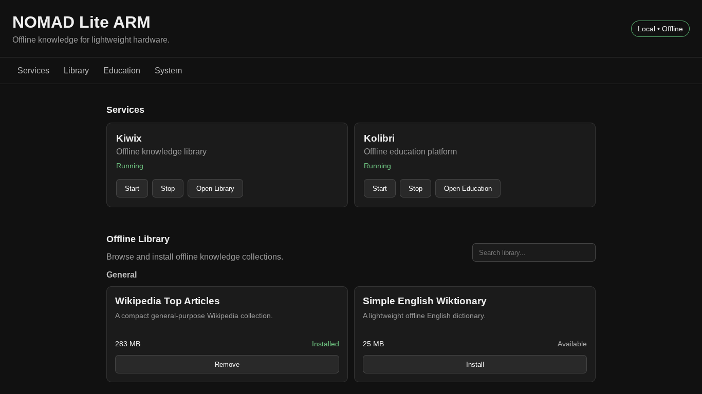

# NOMAD Lite ARM

**Offline reference libraries, education, and maps for lightweight ARM64 Linux devices.**

NOMAD Lite ARM turns low-power hardware into a local-first information hub. It combines **Kiwix** offline libraries, **Kolibri** education, and **NOMAD Maps** in a web dashboard with a simple command-line interface. Download the content you need while connected, then use the installed content without relying on cloud services.

Developed and tested on **Debian 12 (ARM64/AArch64) in a Chromebook Linux environment**. Raspberry Pis, other single-board computers, and other Linux distributions are intended targets but have **not yet been verified**.

> **Status:** Active development / pre-1.0. State map packages are released separately as they are completed. See [available map releases](https://github.com/CarlopeFan77/nomad-lite-arm/releases) and [active state configurations](config/maps).

<p align="center">
  
</p>

## What is included?

| Component | What it does |
| --- | --- |
| **Offline Library** | Download, browse, resume, and manage local ZIM reference collections using Kiwix. |
| **Education** | Install and manage individual offline courses through Kolibri. |
| **NOMAD Maps** | Install selected US-state maps and view roads, places, terrain, hillshade, and contours locally. |
| **Dashboard** | View system status and manage local services, libraries, courses, and maps from a browser. |
| **CLI** | Start/stop services, inspect installed content, and launch the dashboard or map viewer. |

Content is **not bundled with the source code**. You choose the reference collections, educational courses, and state maps to download.

## Quick start

### 1. Check compatibility

Currently supported for automated installation:

- **ARM64 / AArch64** CPU
- **Debian 12** Linux (including the tested ChromeOS Linux Development Environment)
- Internet access during initial package/content downloads
- Sufficient free space for your chosen offline content
- A normal user account with `sudo` access

32-bit ARM, x86/x64 machines, and other distributions are **not currently supported by the automated installer**. A Raspberry Pi with an ARM64 Debian-based OS is a target, but has not been verified in this project yet.

### 2. Clone and install

```bash
git clone https://github.com/CarlopeFan77/nomad-lite-arm.git
cd nomad-lite-arm

# Inspect dependencies without installing anything
./install.sh --check

# Install core dependencies and optionally choose state maps
./install.sh
```

The installer sets up Kiwix, Kolibri, project directories, and required permissions. It then offers an **optional, interactive offline-map selection**. Press Enter at the state prompt to skip maps. You can return to map selection later without running the full system installer:

```bash
python3 scripts/install-maps.py
```

**Important:** The installer targets Debian 12 and may install system packages and configure a third-party Kolibri package source. Review `install.sh` before running it on a machine you depend on.

### 3. Launch the dashboard

```bash
./nomad status
./nomad dashboard
```

Open **http://localhost:8081** in the Linux environment's browser. The dashboard is hosted locally; it is not a public website.

## Offline maps

Choose only the states and packages that fit your device.

| Map profile | Includes | Trade-off |
| --- | --- | --- |
| **Basic** | Offline vector roads, places, water, buildings, and labels | Smaller, faster download |
| **Topo** | Basic plus terrain, hillshade, 3D terrain, and elevation contours | Larger download and more storage |

The map installer lists available states and approximate package sizes **before confirmation**, checks available disk space, downloads package files, and verifies SHA-256 hashes. A previously downloaded, verified package can be skipped when you rerun the installer. Interrupted partial package downloads can be resumed when supported by the source.

Topo packages vary by state. For example, Wyoming's contour package uses 40-foot minor and 200-foot major contours; do not assume the same detail or size applies everywhere.

### Open an installed state

```bash
./nomad maps list
./nomad maps info wyoming

# Requires Wyoming's Basic map to be installed first
./nomad maps start wyoming
./nomad maps open
```

The map viewer is available at **http://localhost:8083/map** while the Maps service is running.

Useful map commands:

```bash
./nomad maps status
./nomad maps stop
./nomad maps logs
./nomad maps validate
```

**Available states:** See the [active installer catalog](config/maps) for currently selectable states, and [GitHub Releases](https://github.com/CarlopeFan77/nomad-lite-arm/releases) for published map packages. A published map release is not necessarily selectable until its state configuration is committed to the active catalog. Work-in-progress configurations live in [`config/maps/wip/`](config/maps/wip).

### Plan storage and download time

- **Basic** is the recommended starting point on a Chromebook or low-storage device.
- **Topo** can be hundreds of megabytes to several gigabytes depending on the state. Its package size alone does not tell you how long installation will take.
- **Allow extra free disk space** beyond the displayed installed size: partial downloads, package assembly, and verification may temporarily use additional space.
- **Keep your device awake** during long map downloads or builds, especially in ChromeOS Linux. Sleep can interrupt terrain work.
- If a package download is interrupted, rerun `python3 scripts/install-maps.py` and select that state again. The installer checks saved parts, attempts to resume partial downloads, and verifies results.
- If you are **building** states rather than installing existing releases, the [state-builder documentation](tools/state-builder/README.md) describes its resumable pipeline. Interrupted terrain tile downloads may continue from existing saved tiles when rerun.

Maps are intended for **offline reference and exploration**, not turn-by-turn navigation or safety-critical decisions.

## Libraries and education

Kiwix serves installed **ZIM** archives for offline reference reading. Kolibri handles structured educational material and course installation. Their content must be downloaded before it will be available offline.

The dashboard is the easiest way to browse and manage them. CLI examples:

```bash
./nomad library list
./nomad library installed
./nomad library info NAME
./nomad library install NAME

./nomad education list
./nomad education info COURSE
./nomad education install COURSE
```

Service commands:

```bash
./nomad start
./nomad stop
./nomad status

./nomad kiwix start
./nomad kiwix stop
./nomad education start
./nomad education stop
```

Use `./nomad help` to see the complete command reference.

## Taking NOMAD offline

Before disconnecting from the internet:

1. Install the program and the services you need.
2. Download at least one desired Kiwix collection, Kolibri course, or state map.
3. Verify that the content opens and that the related local service starts.
4. Keep your content on the device or attached storage that will travel with it.

Internet access is required for initial dependency and content downloads, **not** for viewing content that has already been downloaded and is served locally.

## Troubleshooting

| Symptom | What to try |
| --- | --- |
| `./install.sh` rejects your system | Check `uname -m` and `cat /etc/os-release`. Automated installation is limited to Debian 12 ARM64. |
| A map state is listed but will not open | Install its Basic map, then run `./nomad maps info STATE` and `./nomad maps start STATE`. |
| Maps does not start | Run `./nomad maps logs` and `./nomad maps validate`; confirm the map files are present. |
| Download interrupted | Keep the computer awake, reconnect, and rerun `python3 scripts/install-maps.py`. |
| A newly published state does not appear in the installer | Check whether the state is in `config/maps/`, then update your Git checkout when its configuration is published. |
| Content missing when offline | Confirm the library, course, or map package finished downloading before disconnecting. |

For a reproducible bug report, include your device, ARM architecture, OS version, the command you ran, and relevant error output. Remove private information from logs first.

## Project layout

```text
nomad-lite-arm/
├── config/              # Library, education, and state-map catalogs
│   └── maps/            # Active states; wip/ for in-progress states
├── dashboard/           # Local web dashboard
├── data/                # Downloaded content and local state (not tracked)
├── docs/images/         # README screenshots
├── scripts/             # Service controls, downloaders, and map support
├── tools/state-builder/ # Developer-only map build/release pipeline
├── web/                 # Offline map viewer and bundled map frontend assets
├── install.sh           # Debian 12 ARM64 installer
├── nomad                # CLI
├── CONTRIBUTING.md
└── LICENSE
```

## Roadmap and project status

Development priorities include finishing the state-map catalog, testing installs on clean ARM64 systems and Raspberry Pi hardware, improving compatibility and storage handling, and eventually publishing a dedicated software release. The map builder and its release pipeline are already in place; see [state-builder instructions](tools/state-builder/README.md) if you want to help add a state.

The project is usable for experimentation now, but **has not been broadly validated across ARM64 devices**. Please report what hardware works or fails.

## Contributing

Bug reports, compatibility testing, documentation changes, and code contributions are welcome. Start with [CONTRIBUTING.md](CONTRIBUTING.md) and use [GitHub Issues](https://github.com/CarlopeFan77/nomad-lite-arm/issues) for problems or suggestions.

## Licensing, content, and acknowledgements

NOMAD Lite ARM's source code is licensed under the [Apache License 2.0](LICENSE). Downloaded content and map source datasets have their **own licenses and attribution requirements**. Map configurations identify sources including OpenStreetMap contributors and Mapzen/Tilezen terrain data; using NOMAD does not remove those obligations.

Inspired by **Project NOMAD by Crosstalk Solutions**. NOMAD Lite ARM is an independent project and is not affiliated with or endorsed by Crosstalk Solutions.
